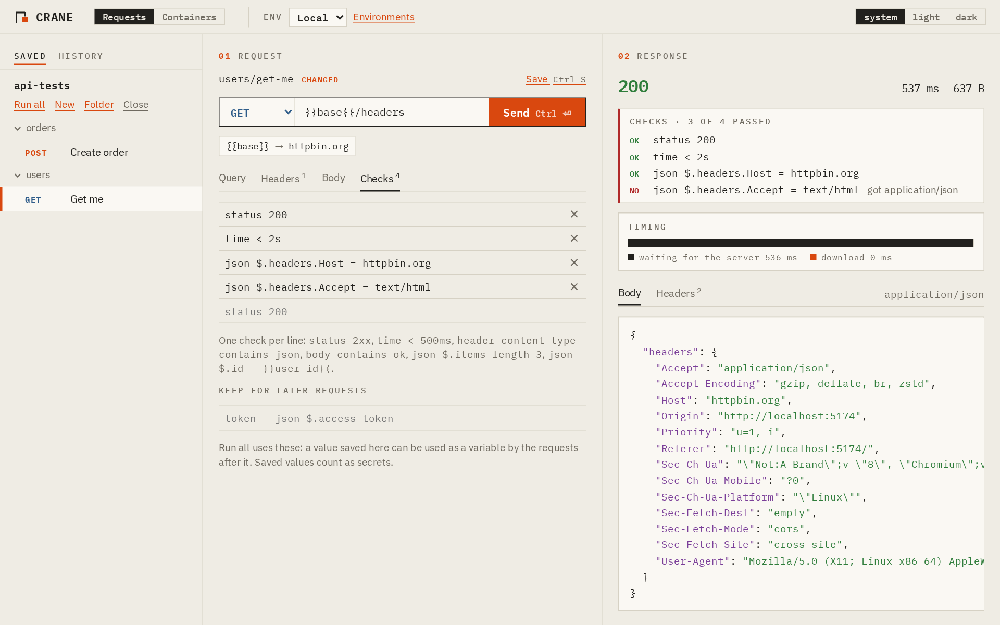
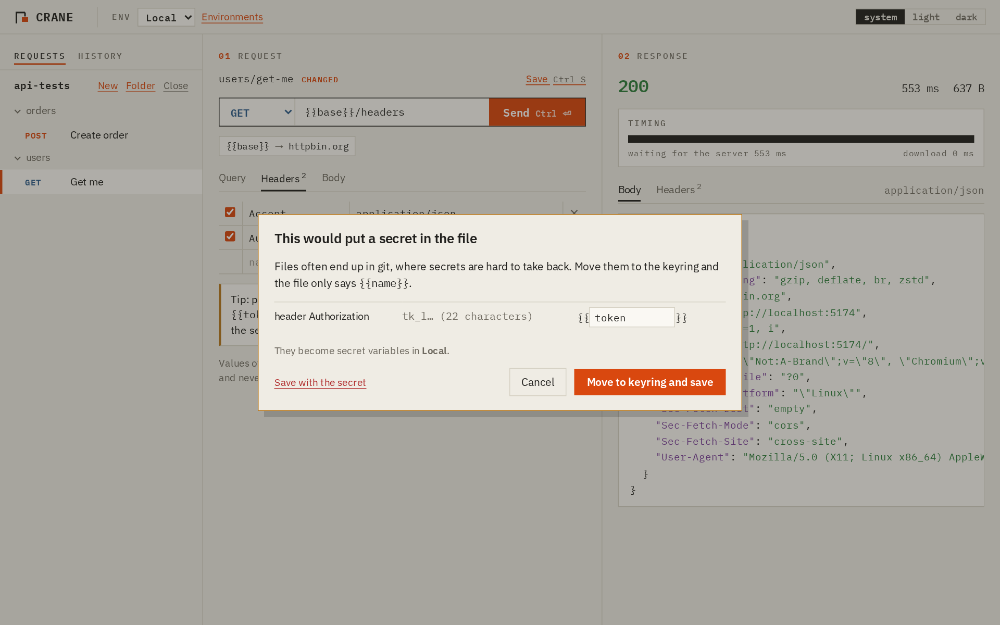

<p align="center"></p>

<h1 align="center">Crane</h1>

<p align="center">An open-source API client that keeps your secrets on your machine,<br>and runs the containers your API needs, without Docker.</p>

<p align="center">
  <a href="https://github.com/jhtjernsmo/crane/actions/workflows/ci.yml"></a>
  <a href="https://github.com/jhtjernsmo/crane/actions/workflows/security.yml"></a>
  <a href="LICENSE"></a>
</p>

<p align="center"><a href="https://jhtjernsmo.github.io/crane/">Website</a> · <a href="docs/requests.md">Docs</a> · <a href="SECURITY.md">Security</a> · <a href="CONTRIBUTING.md">Contributing</a></p>



## Why

API clients hold some of the most sensitive things a developer has: keys, tokens and passwords for production systems. In 2023 Postman [removed its offline Scratch Pad](https://blog.postman.com/announcing-new-lightweight-postman-api-client/) and moved everything into its cloud, and some teams banned it. In 2024 researchers [found more than 30,000 public Postman workspaces](https://www.cloudsek.com/blog/postman-data-leaks-the-hidden-risks-lurking-in-your-workspaces) leaking API keys and tokens.

Crane is built the other way round:

- **No account, no cloud, no telemetry.** The only traffic is the requests you send.
- **Secrets live in the system keyring**, never in files or history. The app can store them but not read them back; Rust fills them in right before sending.
- **Nothing that looks like a key is written to a file** without asking, so collections are safe to keep in git.
- **Production asks first** before anything changes data, and organisations can lock Crane down with a [policy file](SECURITY.md#for-organisations-the-policy-file).

## What it does

| | |
| --- | --- |
| **Requests** | Any method and address, headers, query, JSON, text and form bodies, timing split into lookup, connect + TLS, waiting and download. |
| **Collections** | Plain `.http` files in a folder you choose, readable by VS Code REST Client and JetBrains IDEs too. |
| **Import** | Collections and environments from Postman, Bruno and Insomnia, with their simple test scripts turned into checks and their secrets moved to the keyring. |
| **Environments** | `{{variables}}` per environment, secrets in the keyring, CA files, client certificates and proxies for internal APIs. |
| **Checks** | `status 2xx`, `time < 500ms`, `json $.id = {{user_id}}` in the file; Run all sends a folder and shows what failed. |
| **crane-cli** | The same run in CI, with JUnit output and secrets from environment variables. |
| **Containers** | Crane's own rootless container engine: pull images, run them in their own namespaces, read their logs. No Docker or Podman. |
| **Stacks** | A `crane.toml` lists the services your API needs; Start stack runs them in order and waits until each is ready. |



## Install

Downloads for Linux, macOS and Windows are on the [releases page](https://github.com/jhtjernsmo/crane/releases), each with an SBOM and a build attestation you can check with `gh attestation verify <file> --repo jhtjernsmo/crane`.

To build it yourself you need Rust, Node.js and the [Tauri system packages](https://tauri.app/start/prerequisites/):

```sh
git clone https://github.com/jhtjernsmo/crane && cd crane
npm --prefix ui install
npx --prefix ui tauri build
```

Containers run on Linux; see [docs/containers.md](docs/containers.md) for what they need.

## A quick tour

1. **Send something.** Type `api.github.com/zen` and press Ctrl+Enter. Leave out `https://`; Crane picks `http://` for local addresses and `https://` for the rest.
2. **Add an environment** with `base = http://localhost:8080` and a secret `token`, then send `{{base}}/me` with `Authorization: Bearer {{token}}`.
3. **Open a folder** under Saved and press Ctrl+S. Your request is now a `.http` file you can commit.
4. **Add checks** on the Checks tab, like `status 200` and `json $.name exists`, and press Run all.
5. **Start what your API needs** with a `crane.toml`:

   ```toml
   [[service]]
   name = "db"
   image = "postgres:16-alpine"
   env = { POSTGRES_PASSWORD = "{{db_password}}" }
   ports = ["5432:5432"]
   ready = { port = 5432 }
   ```

6. **Run it in CI:** `crane-cli run api-tests --env CI --stack --junit report.xml`.

## Documentation

- [Requests, environments and secrets](docs/requests.md)
- [Checks and runs](docs/checks.md)
- [Importing from Postman, Bruno and Insomnia](docs/import.md)
- [crane-cli](docs/cli.md)
- [Stacks: crane.toml](docs/stacks.md)
- [The container engine](docs/containers.md)
- [Security and the policy file](SECURITY.md)

## Status

Crane is young (0.1). It has close to 200 tests, including live tests that pull and run real images, but no independent security review yet, and the macOS and Windows builds are less tried than Linux. Please read [SECURITY.md](SECURITY.md) before using it against systems that hold other people's data, and [report what breaks](https://github.com/jhtjernsmo/crane/issues).

## Contributing

Issues and pull requests are welcome; see [CONTRIBUTING.md](CONTRIBUTING.md).

## License

[MIT](LICENSE) © 2026 Jonas Hollund Tjernsmo
