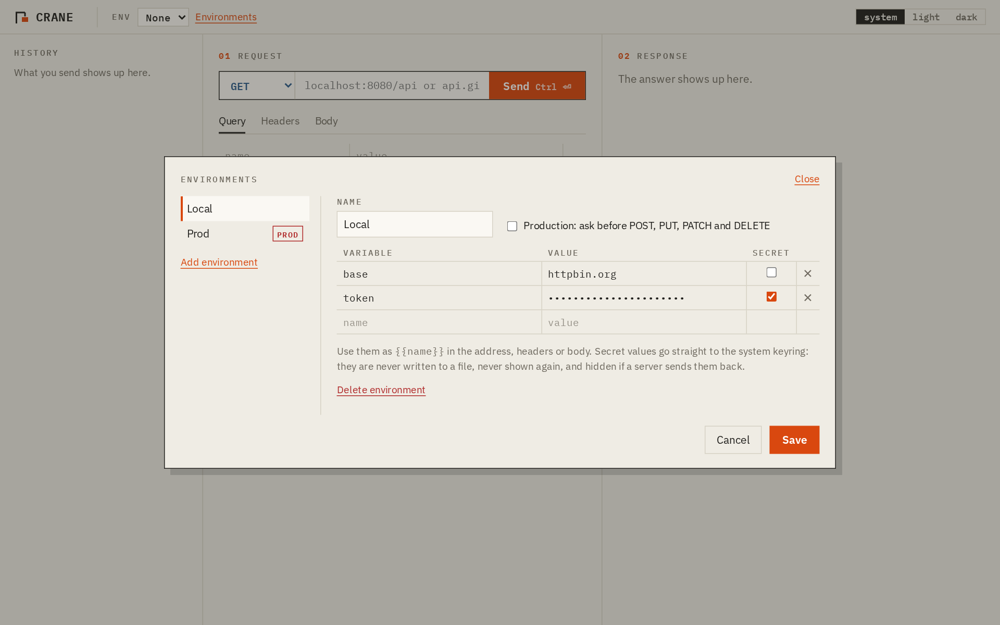
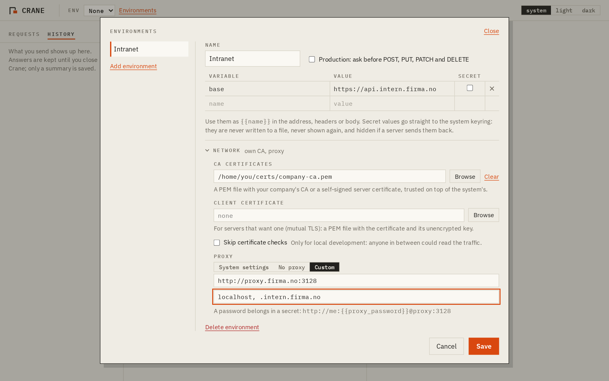

# Requests, environments and secrets

## Requests are files

Open a folder (for example next to your code in git) and every request is a `.http` file in it, the plain-text format VS Code REST Client and JetBrains IDEs also read:

```http
# @name Create order
# @crane body=json
# @expect status 201
POST {{base}}/orders
Accept: application/json
Authorization: Bearer {{token}}
# @disabled X-Debug: 1
Content-Type: application/json

{"item": "crane-001", "qty": 2}
```

- `# @name` is the name in the sidebar; without it, the file name is used.
- `# @crane body=json` tells Crane the body type (`json`, `text` or `form`). Other tools ignore it.
- `# @disabled` keeps a header in the file without sending it.
- `# @expect` and `# @save` are [checks](checks.md).
- A file with several requests (separated by `###`) is shown, but never overwritten: save it as a new file instead.

**Ctrl+S** saves. Before anything is written, Rust scans the request for keys, tokens and passwords; if it finds one, nothing is written and you can move it to the keyring as a variable with one click.

## Environments and variables

An environment is a set of variables, like Local, Test and Prod. Use them as `{{name}}` in the address, headers, body and checks; a line under the address shows what each one turns into before you send.



- Plain values are saved in `environments.json` in the app's data folder, readable only by you.
- **Secret** values go to the system keyring (Secret Service on Linux, Keychain on macOS, Credential Manager on Windows). The app can store them but never read them back: Rust fills them in right before sending, and hides them again (`‹token hidden›`) if a server echoes them in its answer.
- An environment marked as **production** asks before POST, PUT, PATCH and DELETE. Rust checks this too, so the UI cannot skip it.
- **Default headers**, like `Accept: application/json`, are sent with every request in the environment unless the request sets the same header itself. `Content-Type` is only added to requests with a body. They work in Run all and `crane-cli` too, and can use `{{variables}}`.

## Network settings for internal APIs

Each environment can have its own network settings:



- **CA certificates:** a PEM file with your company's CA or a self-signed server certificate, trusted on top of the system's.
- **Client certificate:** a PEM file with a certificate and its unencrypted key, for servers that want mutual TLS.
- **Skip certificate checks:** for local development only. Production environments refuse it, and an organisation can turn it off.
- **Proxy:** the system's settings, none, or your own (HTTP, HTTPS or SOCKS5), with a `{{secret}}` for its password.

## Timing and history

The answer shows where the time went: name lookup, connect + TLS, waiting for the server, and download. Every send opens a fresh connection, so the numbers are not flattered by a reused one.

History keeps the last 500 sends between runs, but only the request and a summary of the answer (status, time, size), never the answer itself. Anything that looks like a secret is replaced before it is written.
